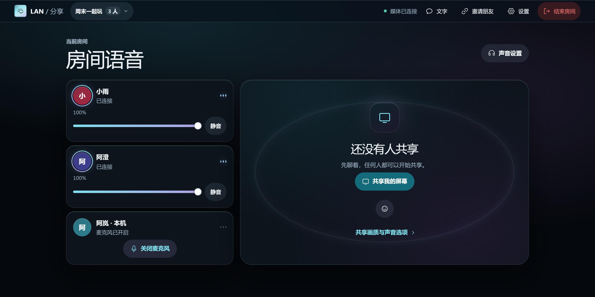

<h1 align="center">LAN / 分享</h1>

<p align="center">同一局域网，一起看同一屏。最多三人共享屏幕、开麦和聊天，无需账号或云端中转。</p>

<p align="center">
  <a href="https://liyan1775.github.io/lan-screen-sharing/">在线宣传页</a> ·
  <a href="https://github.com/liyan1775/lan-screen-sharing/releases/download/v1.0.0/lan-screen-sharing-1.0.0-windows-x64.zip"><strong>下载 v1.0.0 Windows 版</strong></a> ·
  <a href="docs/releases/v1.0.0.md">版本说明</a> ·
  <a href="LICENSE">Apache-2.0 开源</a>
</p>

<p align="center">
  
  
</p>

## 为什么好用

- **零云端，局域网直连。** 无需登录。局域网内可自动发现房间，也能整段粘贴邀请。
- **单次编码，最多两位观众。** 同一份编码画面由分享者本机转发，默认画质目标为 1080p60 / 8 Mbps。
- **Apple Pro 风格玻璃交互。** 深色看屏界面、单行玻璃控制坞、实收画质胶囊和有反馈的动效。
- **局部放大、画中画、一键截屏。** 放大画面细节，按原尺寸保存 PNG。画中画需要浏览器支持。
- **自由麦、按键说话和本机试音。** 支持选麦、独立音量、房间文字链接与一键复制消息。
- **优先推荐真实局域网网卡。** 昵称、头像颜色、麦克风和选用的网卡等偏好可跨重启保留。

## 三步开始

1. **大家运行同一版。** 完整解压 Windows x64 ZIP。先打开 `先看这里.html`，再双击 `局域网屏幕共享.exe`，用桌面版 Edge 或 Chrome 打开本机页面。
2. **一人建房，朋友加入。** 电脑须在能互相访问的私有 IPv4 局域网。朋友可以从“附近的房间”加入，或在“手动加入”粘贴完整邀请。
3. **选择显示器，开始共享。** 点“共享我的屏幕”，选择整个显示器，并按需授权系统声音和麦克风。停止分享后，房间仍可语音和聊天。

## 开发与构建

在 Windows PowerShell 中执行。Go 版本以 `go.mod` 为准，CI 使用 Node.js 24。构建会同时生成第三方许可清单。

```powershell
npm ci
go test ./... -count=1
npm test
$releaseExe = 'dist/release-1.0.0/局域网屏幕共享-1.0.0.exe'
.\scripts\build.ps1 -OutputPath $releaseExe
.\scripts\package-release.ps1 -ExePath $releaseExe
```

| 文档 | 内容 |
| --- | --- |
| [v1.0.0 版本说明](docs/releases/v1.0.0.md) | 正式版功能、升级与验证范围 |
| [版本与发行规范](docs/versioning.md) | SemVer、同版建议、Tag、Release 与 Pages 发布 |
| [系统架构](docs/architecture.md) | 局域网发现、房间信令和媒体通路 |
| [验证与限制](docs/verification.md) | 本机回归、复现方式与实测边界 |

## 开源许可

Copyright 2026 liyan1775。项目采用 Apache-2.0。再分发时按协议保留适用的署名声明。Windows 完整包附带项目许可、署名与第三方组件许可。 [LICENSE](LICENSE) · [NOTICE](NOTICE) · [第三方许可](docs/third-party-notices.txt)
