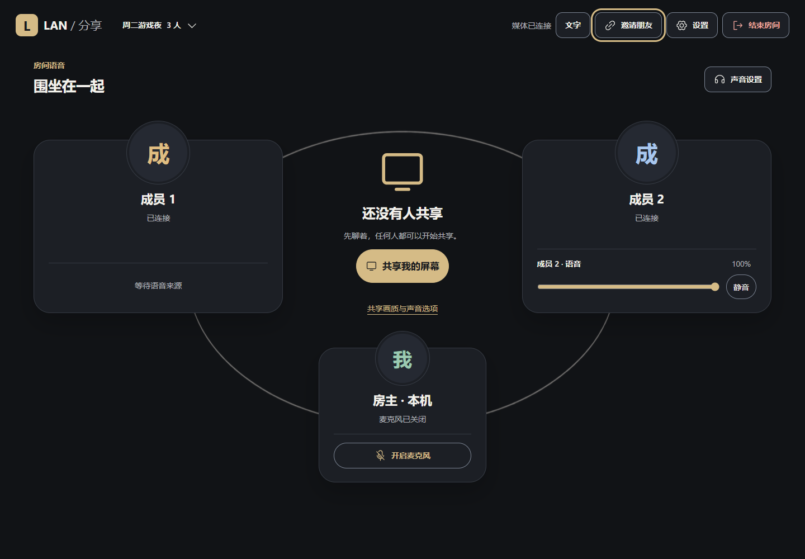

# LAN / 分享 · 局域网屏幕共享

> 0.3.0 已完成真实前端接入和[独立 Apple HIG 设计审查](docs/design-research/apple-hig-independent-review.md)，37 项适用要求通过。设计组合保留在[体验实验室](demos/experience-lab/README.md)，正式程序使用统一的自适应界面。

在互通的私有局域网中，最多三个人共享显示器画面，使用语音或文字交流。每个人运行自己的 Windows x64 单 EXE，在桌面版 Edge 或 Chrome 中使用；媒体和文字通过浏览器点对点传输，本机程序负责房间、发现和信令。



[下载 0.3.0 公开测试版](https://github.com/liyan1775/lan-screen-sharing/releases/tag/v0.3.0) · [前端设计实验室单文件](https://github.com/liyan1775/lan-screen-sharing/releases/download/v0.3.0/frontend-design-lab.html) · [版本说明](docs/releases/v0.3.0.md)

## 可以做什么

- 通过附近房间发现并加入，也可以使用地址、端口和房间码手动加入；公开发现可在创建时关闭。
- 最多三人语音，同一时间一人共享；任一成员停止共享后，另一人可在原房间接着分享。房主负责维持房间。
- 共享整个显示器，可选择画面与语音，或再加入浏览器捕获的系统声音。支持全屏观看、本机音量控制、画质目标和媒体诊断。
- 不开麦也可以使用房间文字交流。文字只发给当前成员，本机仅保留最近 100 条，离开房间或刷新页面后清空。
- 入口与语音界面跟随系统浅深外观；观看时使用深色界面。全屏保留麦克风、声音、文字及退出操作，支持键盘和文字放大。
- 独立的[体验实验室](demos/experience-lab/README.md)保留两轮设计探索，可自由组合阶段结构及视觉主题；它使用模拟房间，不连接真实设备。

## 六步开始

1. 所有参与者下载同一个 0.3.0 测试包并完整解压，在各自 Windows x64 电脑上运行“局域网屏幕共享.exe”，用桌面版 Edge 或 Chrome 打开程序页面。
2. 一人选择“创建房间”，填写房间名并按需要选择是否允许同网发现，然后创建房间。房主离开会结束整个房间。
3. 其他人在“附近的房间”加入；若无法发现，房主点“邀请朋友”，朋友用首页“手动加入”填写地址、端口和房间码。
4. 需要说话时点“开启麦克风”并在浏览器授权；如浏览器阻止播放，按提示点“启用声音”。也可以打开“文字”，用 Enter 发送、Shift+Enter 换行。
5. 想分享的成员在“设置”选择模式，然后点屏幕共享按钮，在浏览器选择**整个显示器**。选择含系统声音的模式时，还需在浏览器允许共享系统声音；没有音轨时按提示选择无游戏声音继续或取消重选。
6. 观众可点“全屏观看”或双击画面，按 Esc 退出全屏。分享者点“停止屏幕共享”会停画面及其系统声音，房间语音继续；其他成员随后可共享。

只聊语音会暂停本机观看和共享声音的播放；如果本机正在共享，选择“只聊语音”会停止自己的共享。恢复后可继续观看。

## 网络、声音与测试状态

所有电脑必须能通过私有 IPv4 网络互相访问。自动发现依赖局域网广播和组播；访客隔离、多网卡、VPN 和防火墙策略可能阻止发现或连接。发现失败可手动加入；软件不提供公网 STUN/TURN 或互联网中继，也不修改防火墙策略。

默认模式不共享系统声音。选择含系统声音的模式时，即使隔离不可用或未确认，浏览器捕获到的系统声音仍会发送；可选听感检查不会自动关声。分享者可主动点“停止共享系统声音”，保留画面和语音。浏览器和系统可能同时捕获其他声音，请在真实设备上检查听感。

0.3.0 是**公开测试版**。真实屏幕/麦克风采集、三台设备、系统声音隔离、后台帧率，以及不同分辨率下的鼠标捕获尚未完成本版验收；实际帧率和兼容性不作保证。EXE 尚未数字签名。已完成的检查及其范围见[验证说明](docs/verification.md)。

## 开发

需要 Go（以 [go.mod](go.mod) 的 1.27 为准）和 Node.js 24。Windows PowerShell 中：

```powershell
npm ci
npm test
npm run lab:build
npm run lab:test
npm run experience:build
npm run experience:test
npm run lab:preview
powershell -NoProfile -File scripts/build.ps1 -BuildVersion 0.3.0
```

构建默认输出 `dist/局域网屏幕共享-0.3.0.exe`，优先使用 PATH 中的 Go；可用 `-GoExe`、`-GoProxy` 和 `-OutputPath` 显式指定。`npm run lab:preview` 启动本机演示服务；实验室本身不访问真实媒体设备。完整 Go 测试为 `go test ./... -count=1`。更多架构和验证细节见[架构](docs/architecture.md)、[验证](docs/verification.md)。

## 许可与素材

**项目尚未指定整体开源许可证。** 第三方组件的原有许可证不因此改变；程序发行包保留 [WebSocket、Go 与图标许可](docs/public-test/0.3.0/开源组件许可.txt)，素材来源见[素材与组件](docs/assets.md)。
