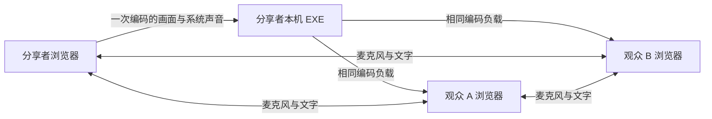

# 架构

每名成员在自己的 Windows 电脑运行 EXE。它在本机提供浏览器页面与控制接口；房主建立房间后提供局域网信令。共享者浏览器通过一条本机 WebRTC 连接编码和发送屏幕视频、系统声音，本机 EXE 使用 Pion 将同一份 RTP 编码负载直接转发到最多两位观众。EXE 不解码、不重新编码，也不保存媒体。成员麦克风仍由浏览器之间的 WebRTC 连接传输，文字由这些连接的 DataChannel 传输。局域网发现使用广播和组播；也支持房主地址、端口及房间码手动加入。

本机上行连接仅接受回环或所选本机 IPv4 地址；下行连接只使用所选本机私有 IPv4 / 回环候选，远端候选限私有 IPv4 / 回环，不配置 STUN 或 TURN。每条 WebRTC 连接单独使用 DTLS/SRTP。RTP 序号、时间戳和编码负载保留；传输相关的 header extensions 移除，SSRC / payload type 由下行连接重新绑定。NACK 在各自传输中处理，观众的关键帧请求向唯一编码器合并，避免两位观众重复触发关键帧。

本机连接先建立并收到接收预算后再挂入采集轨道，防止浏览器按初始互联网带宽估计缩小首批画面。固定的本机接收预算只用于同一台电脑的上行连接；原有三个画质档位的分辨率、帧率和码率上限不变，不按游戏负载自动降档。观众仍须从自身原生接收统计核对实际解码尺寸和帧率。

本机 `/api/v1/screen-relay` 只接受已验证同源本机页面的 POST 控制请求，凭证在请求头中传递。每个页面的随机媒体会话独立，标识只留在本机；另一个页面开始或停止共享不能替换其会话。本机最多保留 16 个发布会话，与页面管理连接上限一致，每个会话最多两位接收者。房间内仅路由 `screen.ready` / `screen.description`，服务端绑定实际成员身份并检查当前共享者，浏览器同时检查共享世代，拒绝迟到的旧协商。共享者可以是房主或任意已加入成员；停止共享、最后一位观众离开或退出程序时会关闭相应转发连接，语音与房间文字保留。

房间最多三名成员，房主维持房间；共享席位同一时间只属于一名已加入成员。停止屏幕共享会保留房间和语音，房主结束房间会通知成员。程序不提供跨网络中继，不改变系统防火墙。

正式程序默认不设置房间时长上限，房间和邀请信息持续有效，直到房主主动结束、退出程序或断线超过恢复保留期。`room.WithRoomTTL` / `app.Config.RoomTTL` 只在调用方明确指定正数时启用固定过期时间；未启用时不创建过期定时器，也不在创建事件中发送 `expiresAt`。

- `cmd/lan-screen-sharing`：程序入口和启动参数。
- `internal/app`、`internal/signal`、`internal/room`、`internal/discovery`、`internal/protocol`：本机服务、信令、房间、发现和消息校验。
- `internal/screenrelay`：单次编码的 RTP 转发、成员连接及媒体资源释放；`screen-relay.js`：浏览器与本机转发的协商和世代隔离。
- `internal/web/assets`：嵌入 EXE 的正式浏览器界面及媒体逻辑。
- `room-experience.js`：入口/语音/观看布局及模态交互，复用媒体和控制节点。
- `room-text.js`、`room-text-ui.js`：房间文字的输入边界、通道、内存消息和可访问界面。
- `demos/frontend-lab`、`demos/experience-lab`：两轮独立模拟设计实验室，不与正式媒体服务连接。

本机页面控制凭证与普通加入信息分开。诊断和反馈不要公开房间码、本机控制凭证或私人画面。详见[验证与限制](verification.md)。

当前单次编码候选的成员需要使用相同构建；旧版浏览器直连视频的协商与这条共享通路不兼容。性能测量、构建哈希及真实游戏验收范围见[单次编码性能记录](performance/2026-11-06-single-encode.md)。

## 刷新与短暂断线

意外断开本机 WebSocket 时，房主房间和成员席位保留 30 秒；本机观众桥接连接关闭时不发送显式离开消息。页面按退避间隔自动重试，保留本机采集，并重建成员之间的媒体协商。刷新后从当前标签页的 sessionStorage 恢复角色、房间与观众恢复凭证；缓存绑定本机服务 ID，主控凭证通过本机 bootstrap 重新取得，不写入浏览器存储。

房主在 `auth.hello` 携带原 `roomId`，验证本机主控凭证后恢复原房间。观众继续使用可轮换的恢复凭证，在旧传输关闭事件尚未到达时也可接管自己的席位；旧连接的迟到关闭不能移除新连接。恢复消息触发重新协商，刷新后不会自动重新采集麦克风或屏幕。主动离开、结束及退出取消恢复并删除缓存；房主超过保留期未恢复则结束房间。最后一个页面关闭后的本机退出宽限也为约 30 秒。
