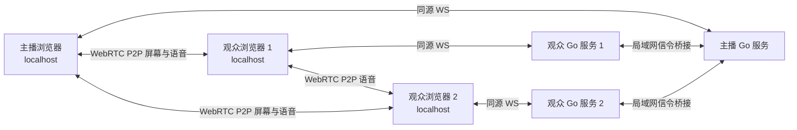

# 局域网游戏画面与语音共享设计

- 日期：2026-11-01
- 状态：用户已于 2026-11-01 批准，进入实现
- 项目目录：`D:\个人项目\局域网屏幕共享`

## 意图与已确认需求

朋友在同一局域网内观看一位主播的整个显示器，并在项目内互相语音。主播双击免安装程序后在浏览器开播；每位参与语音的朋友也先双击同一个便携程序，再在浏览器加入。分享整块显示器是为了主播切换游戏时不必重新选某个游戏窗口。产品轻量、没有安装器，所有分享、语音和观看操作都在浏览器。

**用户已确认**

- 1 名主播，最多 2 名观众/语音参与者，总人数不超过 3 人。
- 主播与参与者位于同一局域网；每位语音参与者接受运行同一个免安装程序，再在浏览器输入主播地址和房间码。
- 主播持续共享整个显示器，允许在直播中切换游戏；项目提供主播与观众之间双向语音。
- 推荐路线为浏览器采集和 WebRTC 媒体、本机轻量服务；仅由 Luna 负责项目工作。

**作者/实现建议**：以 Windows 桌面 Chrome/Edge 为首发目标；首发前在目标 Windows Chrome/Edge 组合验证 `restrictOwnAudio` 并列入支持范围。目前尚未进行真实设备验证，不能视为已有支持结果。房间默认使用临时 8 位无歧义口令和最多 2 个观众席位。1080p60 是实测目标，不是性能承诺。

## 目标、非目标与反目标

### 目标

- 共享用户授权选择的整个显示器的视频；共享音频前检查系统音频隔离能力。
- 让主播与最多 2 位观众在不结束屏幕分享的情况下互相语音。
- 分开处理屏幕视频、屏幕/系统音频和每位参与者的麦克风音频；清楚展示各轨道状态和连接状态。
- 用浏览器 WebRTC 在参与者之间直接传输媒体；Go 服务只服务本地页面和桥接信令。
- 停止屏幕分享时继续语音；离开房间或关闭服务时关闭媒体、信令和临时凭证。

### 非目标与反目标

- 不做账号、文字聊天、录制回放、游戏远控、文件传输、游戏内覆盖层、SFU、云转发、公开房间目录或互联网跨网连接。
- 不声称所有游戏、显卡、浏览器或声音设备均能捕获；不把“检测到音轨”当作“观众听到了声音”。
- 不把屏幕视频限制为某一浏览器标签页或某一游戏窗口；不要求观众只开浏览器而不运行便携程序。
- 不将麦克风轨混入屏幕系统音频轨；不以佩戴耳机或麦克风 AEC 代替系统数字回灌隔离。
- 首版不自动引入 Windows WASAPI 进程音频采集；只有浏览器路线实测失败后才评估该备选。

## Approaches 与选择

| 路线 | 优点 | 代价与边界 |
|---|---|---|
| **选定：每位参与者运行同一便携 EXE，各自在 localhost 使用浏览器；本机服务桥接信令，媒体 P2P** | 主播和观众本机页面都是安全上下文，可用屏幕/麦克风采集；不用给每台设备装证书；不需要云端媒体服务 | 参与语音的朋友必须拿到并双击程序，再输入主播地址和房间码；这比只点 LAN 网页多一步 |
| 可信 HTTPS 的局域网页和 WSS 信令 | 观众无需运行本机程序，仍可浏览器直接访问局域网地址 | 需受浏览器信任的证书；域名/本地 DNS 与证书管理，或逐台安装信任 CA，增加设置工作 |
| 公开可信 HTTPS 网页和 WSS 信令 | 观众操作最简单，可直接打开链接和授权麦克风 | 页面/信令依赖互联网及公网服务；即使媒体可 P2P，也不符合离线优先与本地轻服务取向 |

**用户选定第一条路线**。浏览器页面在每个人自己的 `http://localhost:<port>` 打开；本机 Go 服务使用同源 WebSocket 与页面通信。观众的 Go 服务再作为局域网原生客户端连接主播的信令入口并桥接有限信令消息，避免浏览器页面直接从 localhost origin 请求另一台机器的 HTTP/WS。主播和观众浏览器之间的 WebRTC 媒体连接仍为点对点；Go 服务不转发音视频。

## 架构与角色

- **每台机器的 Go 服务**：同一个 Windows 单 EXE，仅服务该机 `localhost` 页面、页面 WebSocket 和本地房间流程。界面由原生 HTML/CSS/JavaScript 提供。
- **主播 Go 服务**：另监听用户选择的一个私网 IPv4 地址，接收已加入房间的观众服务发来的受限信令。控制 API、控制页和主播控制凭证仅在 loopback listener 上。
- **观众 Go 服务**：由观众在页面中输入主播 LAN 地址、端口和房间码后，主动建立到主播服务的单一信令连接；只桥接该房间规定的加入、SDP、ICE、离开和状态消息，不提供通用代理能力。
- **浏览器媒体拓扑**：3 人以内全网状 WebRTC。每一对参与者建立一个 peer connection；3 人时最多 3 对连接。主播将屏幕视频及（通过隔离检查的）屏幕音频发送给两位观众；三位成员各自的麦克风轨分别发送给其他成员。观众之间另有 P2P 语音连接。无需 SFU，亦不承诺受客户端隔离/防火墙限制的连接必然成功。
- 默认不依赖公网 STUN/TURN；同 LAN 直接连接是首选，但 Wi-Fi 客户端隔离、不同 VLAN、防火墙或浏览器网络策略都可能导致 ICE 失败。跨网连接不在范围内。

## 主播、观众和房间流程

### 主播

1. 双击便携 EXE；它启动本机服务并打开主播 `localhost` 页面。启动界面显示主播可分享的 LAN 地址/端口和退出入口。
2. 点击“创建房间”。服务生成新的短期观众房间码；语音房间随之建立。主播通过外部方式把 LAN 地址、端口和房间码发给朋友。
3. 浏览器点击“选择整个显示器并开始分享”。`getDisplayMedia()` 必须由主播点击触发，浏览器必须显示自己的选择器并由用户授权；`displaySurface: "monitor"` 仅作期望提示，不能绕过选择器静默强选。若用户选了窗口或标签页，页面提示重新选择整个显示器后才开启全屏分享模式。
4. 主播可随时开始/停止屏幕分享；停止屏幕分享只移除屏幕视频/系统音频轨，房间语音继续。
5. 点击“结束房间”或退出 EXE，关闭所有 peer connections、撤销房间码、清理成员与信令状态。异常退出也使内存房间随服务结束失效。

### 观众/语音参与者

1. 双击同一个便携 EXE，在本机 `localhost` 页面选择“加入房间”。
2. 输入主播私网 IP、端口和房间码；观众本机 Go 服务通过 LAN 连接到主播信令入口，页面保持只连接本机同源 WS。
3. 加入后观众按浏览器提示授权麦克风。加入页面可显示观看主机屏幕、语音连接和成员列表。
4. 点击离开时关闭本人的麦克风和所有 peer connections，释放观众席位；短暂断线在有限时间内允许同一成员重连。

## 控制权限与局域网边界

- 每次启动由主播本机服务生成独立高熵主机控制凭证，仅通过 loopback 控制引导流程交给主播页面；主机控制请求及本机主播信令均校验凭证和实际 TCP `RemoteAddr` 为 loopback。Host/Origin 校验仅作纵深防护，不能替代身份验证。
- 房间码只允许观众加入语音/观看；不能结束房间、修改分享、重置口令或冒充主播。主播控制凭证绝不发给观众或交给观众 Go 服务。
- 主播 LAN listener 只服务固定信令入口；观众桥接仅接受固定协议、已知房间和有限的信令消息类型/大小。观众端只允许输入私网 IP 和合法端口，协议类型及路径固定；不能让观众服务代理任意地址或公网请求。
- 主播最多 2 个观众席位。临时观众码可为 8 位无歧义随机字符，输错按来源限速。成员有独立临时会话标识/重连凭证；离房、超时或房间结束后失效。建议断线席位保留 20 秒后回收。
- 本地页面和 LAN 信令使用 HTTP/WS，面向可信局域网；WebRTC 媒体自身经加密传输。启动时仅绑定 loopback 与用户选择的私网地址；不能找到可用私网地址或监听失败时明确报错，不悄悄开放所有接口。

## 媒体轨道与语音隔离

### 轨道身份与传输

必须把三类音视频来源分开处理，按参与者 ID、媒体角色和 WebRTC stream/transceiver 映射；不能只凭“收到一个 audio track”推断用途。

| 来源 | 创建方式 | WebRTC 用途 | 本地播放/界面 |
|---|---|---|---|
| 屏幕视频 | 主播 `getDisplayMedia()` 的 video track | 仅主播→每位观众 | 主播本地预览；观众主画面 |
| 屏幕/系统音频 | 同一屏幕捕获调用返回的可选 audio track | 仅主播→每位观众，标记为“游戏/系统音频” | 预览默认静音；与语音分别控制音量 |
| 参与者麦克风 | 每位成员 `getUserMedia({audio:true})` 单独返回的 track | 该成员→其余成员，标记为成员语音 | 本人麦克风静音；远端成员独立接收静音/音量控制 |

每位成员只在其麦克风轨道发送语音，不把麦克风 track 混进屏幕音频 track，也不把屏幕音频重复附加为 voice。不同 track 使用独立 stream 和明确角色映射。接收语音在独立的成员音频节点播放；本机屏幕预览 muted，避免本地回放进入系统音频捕获。关屏幕游戏声音与关语音是分开的控件。

### 系统音频回灌控制

- 主播系统音频请求使用 `systemAudio: "include"`，并在系统音频约束上请求 `restrictOwnAudio: true`。本项目所有远端语音播放必须在主播调用 `getDisplayMedia()` 的同一 document 内，避免把聊天播放置于另一个标签页/进程。
- 此隔离只针对发起采集的本项目页面自身播放的音频；Discord、其他应用或其他标签页的系统回放仍可能进入直播。首版内置语音用于替代同房间的外部语音，不承诺排除所有外部应用音频。
- 开始系统音频+语音前检测 `navigator.mediaDevices.getSupportedConstraints().restrictOwnAudio`，然后检查捕获 audio track 的 `getSettings().restrictOwnAudio`。前者仅说明浏览器认识该约束；后者必须明确为 `true` 才能继续尝试。两者都不是内容上的声学验收；支持矩阵还须经真实三人语音回灌测试确认。
- 首发支持的 Chrome/Edge 版本必须在 Windows 实机通过“游戏声音保留、远端语音不进入主播系统音轨”的三人测试。版本或设置未列入已验证组合、约束缺失/未应用、或之前失败时，不能自动启动“系统音频 + 项目语音”。提示升级支持的桌面浏览器；可显式切到“画面 + 语音（无游戏声音）”受限模式，且明确显示不包含游戏/系统音轨，不能标记为完整需求满足。
- `getUserMedia()` 麦克风可请求 `echoCancellation: "remote-only"`（实现支持时）处理麦克风中的远端声学回声。AEC 作用于麦克风，不解决系统 loopback 中的数字回灌；戴耳机也只能帮助声学测试，不能证明 `restrictOwnAudio` 数字隔离有效。
- 仅当实际收到相应 track 才分别显示“已捕获屏幕音频”“已接收屏幕音频”“麦克风已开启”“已接收某成员语音”。这些状态不表示有人确实说话或听到了声音；测试需观众实际确认。

### 声音控件

- 主播：屏幕音频开关、麦克风静音、各成员语音接收静音/独立音量、结束语音房间；麦克风静音不得停止屏幕音频。
- 观众：自己的麦克风静音、屏幕/游戏音频接收静音、逐成员语音静音/音量。
- 不实现文字聊天、复杂混音器、降噪控制面板或音频设备路由。

## 视频目标与状态

- 主播选择整个显示器，保持持续共享并可随时切换游戏；切换应用不应自动停止分享。窗口或标签页误选时提示重选显示器。
- 目标画质档位：1080p60，回退 720p60，再回退 720p30。显示目标档位与实际捕获/发送/接收 `getSettings()`、`getStats()` 分辨率、帧率、码率、丢帧分开呈现；不以接收端 CSS 缩放宣称降低实际传输分辨率。默认码率由实测确定。
- 屏幕轨意外结束时只报告“屏幕分享已结束”，房间语音保持连接；主播明确结束房间才同时关闭语音。
- 页面分别显示：屏幕分享状态、系统音频隔离状态、系统音频轨状态、每位成员麦克风/语音轨和连接状态、接收/发送统计、房间人数（1/3 到 3/3）。自动播放被阻止时提示成员点击播放/解除静音。
- 独占全屏捕获黑屏、冻结或错画面时建议游戏切到无边框窗口/窗口化后继续共享整个显示器；这只是兼容性建议，不改变整屏产品定位。

## 技术栈与打包建议（作者建议）

此前只读检查：当前环境 Node.js `v24.12.0` 可用；`go` 未安装；Python Launcher 可用。Go 未安装不改变选型；实现时从官方 Go Windows 工具链获取便携版本，放在项目外任务专用缓存目录，以绝对路径调用，不修改全局 PATH、不做系统安装。

- 服务端：Go `net/http` + `go:embed` + 一项小型 WebSocket 依赖（建议评估 `github.com/coder/websocket`），构建目标 Windows 单 EXE。EXE 是本地服务与信令桥，不负责发送媒体；双击后打开本机浏览器。
- 浏览器：原生 HTML/CSS/JavaScript、Screen Capture API、WebRTC；不用前端框架、转码库、数据库或公网服务。
- 每位参与者运行同一便携 EXE。主播服务提供私网邀请地址与房间；观众服务按固定加入协议连接主播并桥接信令。用户分享 LAN 地址和房间码；语音/观看操作都在 localhost 浏览器中完成。
- 端口冲突时尝试有限次数随机临时端口，失败时明确报错；若打不开浏览器，显示可复制 localhost 地址。关闭窗口或退出命令优雅停止 listener/桥接/peer 状态；不安装系统服务、不需要管理员权限或自动改防火墙规则。
- Go 和依赖版本在实现时按官方来源核定。目标 exe 大小、启动速度和运行性能均不预先承诺。

## 本地开发与验证策略

### 可自动化或浏览器回环验证

- 两个角色的 localhost 页面、安全上下文和同源 WebSocket；主播控制凭证只在 loopback 授权，伪造 Host/Origin 仍无法越权；观众房间码不能调用主播控制。
- 主播 LAN 信令入口、观众本地 Go 桥接只允许规定的 LAN 地址/端口、房间和信令协议；拒绝公网目标、任意代理消息/过大 payload；主机/观众角色隔离。
- 房间码过期、最多 2 位观众、第三位拒绝、重连超时与席位回收；语音成员加入/离开/重连状态。
- 屏幕视频、屏幕音频、每位麦克风的 stream/track 角色映射；静音和音量路由；停止屏幕分享时语音继续，结束房间时所有连接清理。
- `restrictOwnAudio` 功能支持检测与轨道设置检测、失败降级；Go Windows EXE 构建、端口冲突、启动、退出。
- 浏览器回环合成媒体只能验证协议、轨道映射与状态，不能证明实际游戏采集、硬件麦克风可用、系统音轨正确隔离或观众真听到声音。

### 必须真实设备与真实游戏验收

- 至少 3 台参与者设备（主播+2 观众），Windows 桌面 Chrome/Edge；同一无客户端隔离的 LAN。记录 OS Build、浏览器和版本、硬件/GPU、游戏、显示模式、音频设备作为报告字段。
- 三人持续共享整个显示器并互相说话至少 10 分钟，游戏内至少切换一次；确认连接无非预期中断、语音拓扑成员齐全，主播停止屏幕分享后语音仍继续。
- 逐人确认自己的远端语音不会再次从直播屏幕音轨被其他人听到；确认游戏声音能被观众听到；测试主播及观众独立麦克风静音、语音静音/音量与屏幕声音控制互不串线。
- 同场景记录共享前后主播游戏 FPS、共享中平均 FPS、发送/接收 FPS、丢帧、码率、CPU/GPU及重连。可将稳定 60 fps、低延迟作为优化目标；没有实机记录不得宣称性能通过。
- 用耳机可用于额外检查声学回声，但不能替代或证明系统数字音频隔离。若无法确认 `restrictOwnAudio` 生效或仍有回灌，完整“游戏系统声音 + 内置语音”模式判为不通过；验证“画面 + 语音，无游戏声音”降级模式，原生 WASAPI 进程音频列为后续评估。
- 实际游戏型号和硬件为验收报告字段，不是开始实现的阻塞问题。

## 后续备选：Windows WASAPI 进程 loopback

Windows 进程 loopback API 可按指定 PID 及其子进程树 include 音频，或从系统混音 exclude 该进程树；只捕获游戏进程树可避免捕获另一个独立语音程序的回放。微软样例和结构文档标注最低 Windows 10 Build 20348；`ActivateAudioInterfaceAsync` 文档另列 Build 20438 的 include/exclude 起始说明，版本资料有差异，实现前需按保守版本/实机确认。本机只读 BuildNumber 为 26200。该路线要开发本机采集助手，并把 PCM 送进浏览器媒体流或由 native helper 自行发送、处理时钟与同步；仅在浏览器音频隔离失败后评估，不自动进入首版。

## 官方技术参考

- W3C Screen Capture：用户选择显示表面、采集授权和音频安全语义。<https://www.w3.org/TR/screen-capture/>
- MDN `getDisplayMedia()`：安全上下文、用户激活、系统音频与约束。<https://developer.mozilla.org/en-US/docs/Web/API/MediaDevices/getDisplayMedia>
- Chrome 141 release notes：`restrictOwnAudio`、`windowAudio` 与麦克风 `echoCancellationMode`。<https://developer.chrome.com/release-notes/141>
- Microsoft Edge 141 Web Platform release notes：相同 API 在 Edge 的发布记录。<https://learn.microsoft.com/en-us/microsoft-edge/web-platform/release-notes/141>
- MDN `restrictOwnAudio` 语义与实验标记。<https://developer.mozilla.org/en-US/docs/Web/API/MediaTrackConstraints/restrictOwnAudio>
- MDN 检查约束支持与 track settings：<https://developer.mozilla.org/en-US/docs/Web/API/MediaTrackSupportedConstraints/restrictOwnAudio>、<https://developer.mozilla.org/en-US/docs/Web/API/MediaStreamTrack/getSettings>
- MDN `getUserMedia()` 安全上下文与麦克风权限。<https://developer.mozilla.org/en-US/docs/Web/API/MediaDevices/getUserMedia>
- Chrome screen capture `suppressLocalAudioPlayback` 语义。<https://developer.chrome.com/blog/screen-sharing-improvements-in-chrome-109>
- Go `net/http`、`embed` 和 coder WebSocket：<https://pkg.go.dev/net/http>、<https://pkg.go.dev/embed>、<https://github.com/coder/websocket>
- Microsoft WASAPI process loopback 样例、模式枚举和参数结构：<https://learn.microsoft.com/en-us/samples/microsoft/windows-classic-samples/applicationloopbackaudio-sample/>、<https://learn.microsoft.com/en-us/windows/win32/api/audioclientactivationparams/ne-audioclientactivationparams-process_loopback_mode>、<https://learn.microsoft.com/en-us/windows/win32/api/audioclientactivationparams/ns-audioclientactivationparams-audioclient_process_loopback_params>

## 需求变更记录

原设计把观众当作只接收媒体的 HTTP 网页，因此不需要观众麦克风权限。用户后来要求项目内语音并接受每位语音参与者运行同一便携程序；本稿以各端 localhost 页面和局域网信令桥接替代旧 viewer HTTP 页面假设。原设计未获批准，也未进入实现。
